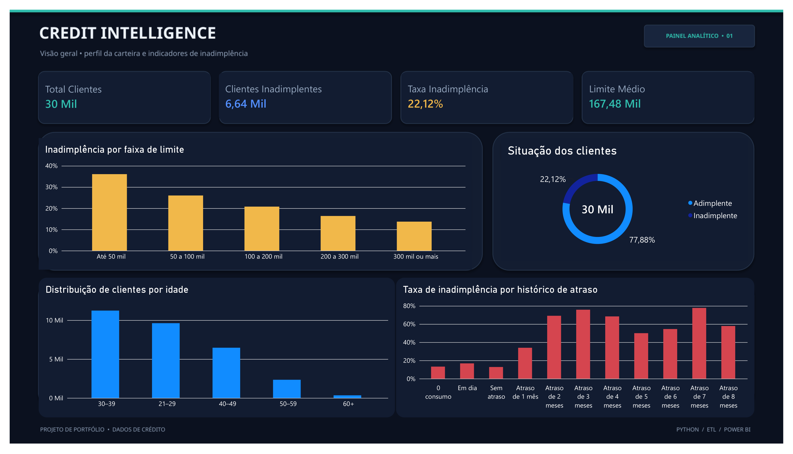
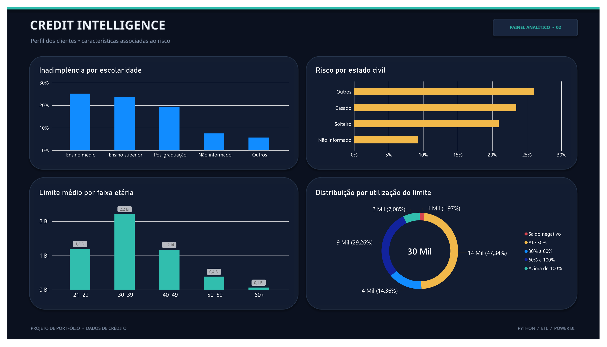
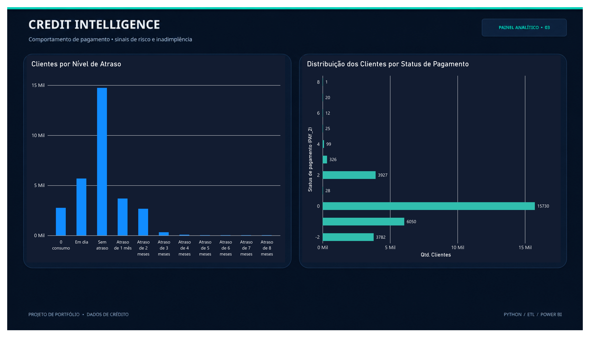

# Credit Intelligence — Análise de Risco de Crédito

Projeto de análise de dados voltado à identificação de padrões associados à inadimplência de clientes de cartão de crédito, utilizando Python, SQL, PostgreSQL e Power BI.

O objetivo é transformar dados de clientes e histórico de pagamentos em informações que ajudem a compreender o comportamento de pagamento e a distribuição do risco de crédito.

## Objetivos do projeto

- Construir um processo de ETL com Python.
- Validar e transformar os dados antes de carregá-los no banco.
- Armazenar os dados tratados no PostgreSQL.
- Investigar padrões de inadimplência com consultas SQL.
- Desenvolver um dashboard interativo no Power BI.
- Comunicar os resultados por meio de indicadores e visualizações.

## Tecnologias utilizadas

- **Python:** extração, transformação e validação dos dados.
- **Pandas:** manipulação e análise dos dados.
- **PostgreSQL:** armazenamento e consultas analíticas.
- **SQL:** agregações, segmentações e comparação de indicadores.
- **Power BI:** criação do dashboard.
- **Jupyter Notebook:** exploração dos dados.
- **Git e GitHub:** versionamento e documentação do projeto.

## Base de dados

O projeto utiliza a base *Default of Credit Card Clients*, composta por 30.000 registros de clientes e variáveis relacionadas a características demográficas, limite de crédito, histórico de pagamentos e inadimplência no mês seguinte.

A variável `default_payment_next_month` indica a ocorrência de inadimplência no mês seguinte:

- `0`: sem inadimplência registrada no período-alvo.
- `1`: inadimplência registrada no período-alvo.

A base original não é disponibilizada neste repositório. Para executar o projeto, é necessário obter o arquivo de origem e colocá-lo na pasta `data/raw/`.

## Processo de ETL

O processo implementado em Python contempla:

1. **Extração:** leitura do arquivo original.
2. **Transformação:** padronização de nomes de colunas e tratamento de categorias.
3. **Validação:** verificação de colunas esperadas, valores ausentes e duplicidades.
4. **Carga:** gravação dos dados tratados no PostgreSQL.
5. **Exportação:** geração de um arquivo CSV com os dados processados.

O processo utiliza variáveis de ambiente para as configurações de conexão com o banco de dados.

## Análises realizadas

As consultas SQL investigam diferentes aspectos da inadimplência.

### 1. Visão geral

- Total de clientes.
- Quantidade de inadimplentes e adimplentes.
- Taxa geral de inadimplência.

### 2. Histórico de pagamento

- Quantidade de clientes por categoria de atraso.
- Taxa de inadimplência em cada grupo.
- Diferença em pontos percentuais em relação à taxa geral.
- Participação de cada grupo no total de inadimplentes.

### 3. Limite de crédito

- Segmentação dos clientes por faixas de limite.
- Comparação das taxas de inadimplência entre as faixas.
- Diferença em relação à taxa geral.
- Participação de cada faixa no total de inadimplentes.

### 4. Faixa etária

- Segmentação dos clientes por idade.
- Comparação das taxas de inadimplência entre grupos.
- Identificação de grupos acima ou abaixo da taxa geral.
- Participação de cada faixa no total de inadimplentes.

### 5. Análise combinada

- Cruzamento entre faixa etária e faixa de limite de crédito.
- Comparação da quantidade de clientes e da taxa de inadimplência por combinação.
- Avaliação da diferença em pontos percentuais em relação à taxa geral.

### Métricas utilizadas

- **Taxa de inadimplência:** proporção de clientes inadimplentes dentro de um grupo.
- **Diferença em pontos percentuais:** diferença entre a taxa do grupo e a taxa geral da base.
- **Participação no total de inadimplentes:** proporção de todos os inadimplentes que pertence a determinado grupo.
- **Quantidade de clientes:** dimensão da amostra de cada grupo, importante para interpretar os resultados.

## Dashboard Power BI

O dashboard foi organizado em três páginas para facilitar a exploração dos indicadores.

### 1. Visão geral



### 2. Perfil dos clientes e análise de risco



### 3. Comportamento de pagamento



O arquivo editável do dashboard está disponível em `dashboards/credit-intelligence.pbix`.

## Estrutura do projeto

```text
credit-intelligence/
├── dashboards/
│   └── credit-intelligence.pbix
├── data/
│   ├── raw/
│   └── processed/
├── notebooks/
│   └── 01-exploracao.ipynb
├── reports/
│   ├── comportamento-pagamento.png
│   ├── perfil-dos-clientes.png
│   └── visao-geral.png
├── sql/
│   ├── analises.sql
│   └── validacao_dados.sql
├── src/
│   ├── etl.py
│   └── test_connection.py
├── .gitignore
├── README.md
└── requirements.txt
```

As pastas `data/raw/` e `data/processed/` são mantidas localmente e ignoradas pelo Git.

## Como executar o projeto

### Pré-requisitos

- Python instalado.
- PostgreSQL instalado e em execução.
- Banco de dados `credit_intelligence` criado.
- Arquivo original disponível localmente.
- Dependências do projeto instaladas.

### 1. Clonar o repositório

```bash
git clone https://github.com/Guisilva29/credit-intelligence.git
cd credit-intelligence
```

### 2. Criar um ambiente virtual

```bash
python -m venv .venv
```

Ativar no Windows PowerShell:

```powershell
.\.venv\Scripts\Activate.ps1
```

### 3. Instalar as dependências

```bash
pip install -r requirements.txt
```

### 4. Configurar o banco de dados

Crie o banco `credit_intelligence` no PostgreSQL e configure o arquivo `.env` na raiz do projeto com a variável de ambiente necessária:

```env
POSTGRES_PASSWORD=sua_senha_local
```

Não publique o arquivo `.env` nem credenciais reais no GitHub.

### 5. Disponibilizar a base original

Coloque o arquivo `default of credit card clients.xls` no seguinte caminho:

```text
data/raw/default of credit card clients.xls
```

### 6. Executar o ETL

```bash
python src/etl.py
```

### 7. Executar as consultas SQL

Utilize o PostgreSQL para executar as consultas disponíveis em:

- `sql/analises.sql`
- `sql/validacao_dados.sql`

### 8. Abrir o dashboard

Abra `dashboards/credit-intelligence.pbix` no Power BI Desktop.

## Principais resultados

Na análise realizada, a base apresentou:

- **30.000 clientes analisados**
- **6.636 clientes inadimplentes**
- **23.364 clientes sem inadimplência registrada no período-alvo**
- **Taxa geral de inadimplência de 22,12%**

As conclusões segmentadas por histórico de pagamento, limite de crédito e idade devem ser registradas após a execução e validação das consultas SQL.

## Considerações e limitações

Este projeto tem caráter exploratório e descritivo. As análises identificam associações observadas na base, mas não demonstram relações de causa e efeito.

O projeto não implementa um modelo preditivo de inadimplência e não deve ser interpretado como um sistema de decisão automatizada de crédito.

Os resultados dependem da base utilizada e do correto processamento dos dados.

## Autor

**Guilherme Oliveira Silva**

Estudante de Análise e Desenvolvimento de Sistemas na FATEC São Caetano do Sul, com foco em Análise de Dados e Business Intelligence.

Tecnologias de interesse: Python, SQL, PostgreSQL e Power BI.

- GitHub: [Guisilva29](https://github.com/Guisilva29)
- LinkedIn: [Guilherme Oliveira Silva](https://www.linkedin.com/in/guilhermeoliveiraslv/)
